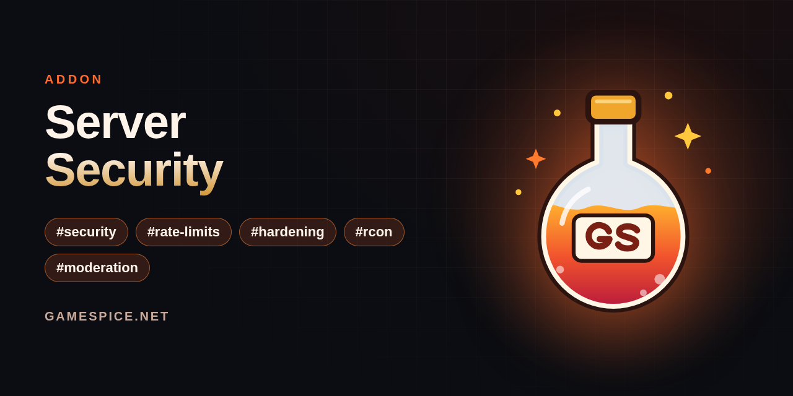

[](https://moddingcommunity.com/a/58-gs-server-security)

Watches what happens on a dedicated server, counts it against rules an operator writes, and escalates (warn, gag, mute, kick, ban) without anybody having to be awake. It also checks join attempts against external ban lists and has server-side anti-cheat checks.

## Ships doing nothing

Every rule starts in dry run. It counts, logs and fills in `sec_status`, and punishes nobody until you say so. Run it for a week, read `sec_status`, then set `sv_security_dryrun 0`. An addon that punishes an existing community on thresholds nobody chose gets uninstalled after the first false positive.

## Install

1. Get [Godot 4.7](https://godotengine.org/download).
2. Either use [GameSpice Bootstrap](https://github.com/gamespice-platform/bootstrap), which clones every project and links the addons, or copy `addons/dot_server_security/`, [GameSpice Core](https://github.com/gamespice-platform/core)'s `addons/dot_core/` and [GameSpice Server](https://github.com/gamespice-platform/server)'s `addons/dot_server/` into your project and enable dot-server-security in *Project > Project Settings > Plugins*.

```gdscript
var guard := GSSecurityManager.new()
server.add_child(guard)

var watch := GSSecurityWatch.new()      # wires it to everything worth watching
server.add_child(watch)
```

[GameSpice Moderation](https://github.com/gamespice-platform/moderation), [GameSpice Chat](https://github.com/gamespice-platform/chat) and [GameSpice Auth](https://github.com/gamespice-platform/auth) are optional and found at runtime.

## Rules

A rule is: this many of that event, from one subject, within this window, then take the next step on the ladder.

```json
{
  "id": "chat_flood",
  "event": "chat.message",
  "threshold": 6,
  "window_sec": 10,
  "scope": "uid",
  "cooldown_sec": 15,
  "steps": [
    {"action": "warn", "message": "Slow down, please."},
    {"action": "gag",  "duration_sec": 300},
    {"action": "gag",  "duration_sec": 1800},
    {"action": "kick"}
  ]
}
```

Six messages in ten seconds: a warning, then five minutes, then half an hour, then out. Offences are remembered for `offence_memory_sec`, so someone who spammed this morning does not start again at "warn" tonight. `cooldown_sec` stops a rule whose action does not stop the behaviour (a warning) from walking its whole ladder on the next message.

| Scope | Counts against | Use for |
| --- | --- | --- |
| `uid` | The person. Follows them to a new address. | Chat, commands, votes. |
| `address` | The network address. | Things before there is an identity: connection floods, wrong RCON passwords. |
| `both` | Both, separately. | Catching "this account spams" and "this address spams from a new account each time". |

### Events watched

| Events | Source |
| --- | --- |
| `chat.message`, `chat.duplicate`, `chat.caps`, `chat.link`, `chat.refused`, `chat.command` | Text chat, from the server's own path and GameSpice Chat |
| `connect.attempt`, `connect.rejected`, `connect.churn` | Connections, including reconnect loops |
| `auth.failed`, `auth.rejected` | Authentication, with GameSpice Auth |
| `rcon.auth_failed`, `rcon.command` | Remote console |
| `command.denied` | Probing for commands somebody does not hold |
| `cheat.*` | The anti-cheat detectors |

The vocabulary is open. `guard.report_session(&"fc.buy_menu_spam", session)` gives your own event the whole engine: windows, thresholds, ladders, exemptions, dry run and `sec_why`.

## Anti-cheat

Detections are ordinary events, so the rules above apply to them. There are two kinds.

| Kind | Examples | Treatment |
| --- | --- | --- |
| Impossible: the server re-simulated the claim and it does not fit | Moving further in a tick than movement code allows, firing faster than the weapon allows | A rule may punish on one. |
| Suspicious | Aim that snaps, aim too smooth for a hand, firing inside human reaction time, an extreme headshot rate | They accumulate, warn and tell admins. Shipped rules never punish on them, and the detector refuses at boot to punish on a single detection. |

The strongest check is a re-simulation of your movement code:

```gdscript
ac.movement_reference = func(session, from, velocity, command, delta) -> Vector3:
    return my_controller.simulate(from, velocity, command, delta)
```

Without one, the envelope limits (`max_horizontal_speed` and friends) are the fallback. They ship at 0 (off) because the honest way to set them is to read the peaks off `sec_ac_status` after a week of your own game.

What it cannot do: there is no client-side part, since a Godot game ships its scripts to the player. It cannot find a well-written wallhack. The answer to that is not sending the data (interest management in the netcode).

## External ban lists

Any number of endpoints, merged, cached and consulted on every join.

```json
{
  "id": "network",
  "url": "https://bans.example.net/api/v1/active",
  "auth": "bearer",
  "token_file": "user://cfg/network.token",
  "list_path": "data.bans",
  "on_failure": "keep_last"
}
```

| Aspect | Supported |
| --- | --- |
| Auth | Public, bearer (static key or JWT), basic, custom header, query parameter, timestamp-nonce-HMAC |
| Formats | Array of strings, array of objects with several field names, wrapper object, `{"uids": [...], "ips": [...]}` |
| Entries | IDs, addresses and CIDR ranges (a `/24` is matched, not expanded). Expiries are honoured. |
| Cache | Written to disk, so a restart during an outage still enforces. |
| `on_failure` | `keep_last` (default), `ignore` or `refuse_all` |

Tokens come from a file (`token_file`), never the environment or command line. GameSpice Moderation registers under the same `dot_ban_source` name, so both are asked and both must say yes.

## With and without Moderation

With GameSpice Moderation a gag is a stored, expiring, revocable record that survives a reconnect and restart. Without it, a gag is two flags on the session and is lost when the player reconnects. Both work.

## Commands

```
] sec_why Someone
2 record(s) matching 'Someone':
  2026-09-12T14:02:11  chat_flood  account u-8813  offence 2: 7 x chat.message in 10s -> gag 5m
  2026-09-12T14:39:40  chat_repeat account u-8813  offence 1: 3 x chat.duplicate in 30s -> warn
```

| Command | Does |
| --- | --- |
| `sec_why <name>` | Explains why someone was punished. |
| `sec_forget <name>` | Clears someone's counters, after lifting a punishment by hand. |
| `sec_status`, `sec_rules`, `sec_rule <id>`, `sec_log` | Show state, rules and the log. |
| `sec_enable`, `sec_disable`, `sec_reload`, `sec_dump` | Control the guard. |
| `sec_test` | Feed synthetic events to prove a rule fires. |
| `sec_bans`, `sec_bans_refresh`, `sec_bans_check` | External ban lists. |
| `sec_ac_status`, `sec_ac_dryrun` | Anti-cheat. |
| `sv_security`, `sv_security_dryrun` | Live switches. |

## Testing

Import the project once, then run `examples/security_selftest.tscn` headless with Godot.

## Status and licence

Part of the [**GameSpice**](https://gamespice.net) platform: a family of Godot addons. Written with Claude Code and maintained by `gamemann`. Every addon has headless tests, but little of this has been played by real users yet, so expect rough edges and please [open an issue](https://github.com/gamespice-platform/server-security/issues) when you hit one.

MIT licence, see [LICENSE](LICENSE). The only closed part of the [**GameSpice**](https://gamespice.net) platform is the web back end; you can use your own instead of GameSpice's.
